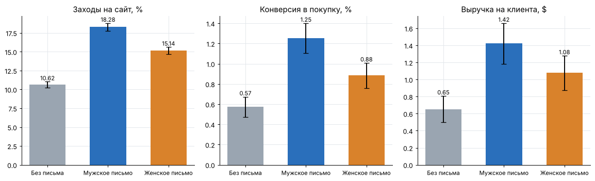
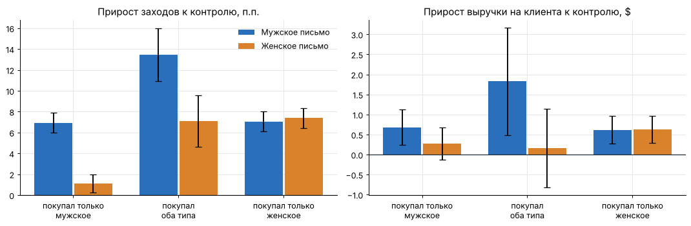

# A/B-тест email-рассылки интернет-магазина

Анализ рандомизированного эксперимента с тремя группами: какая рассылка увеличивает заходы на сайт, покупки и выручку, для каких клиентов она работает и кому ее отправлять.

**Инструменты:** Python (pandas, NumPy, SciPy, matplotlib), статистические критерии, бутстрэп.

## Данные

[MineThatData E-Mail Analytics Challenge](https://blog.minethatdata.com/2008/03/minethatdata-e-mail-analytics-and-data.html) (Kevin Hillstrom, 2008) — реальный эксперимент интернет-магазина. 64 000 клиентов, покупавших за последние 12 месяцев, случайно разделены на три группы:

| Группа | Клиентов |
|---|---|
| Письмо с мужскими товарами | 21 307 |
| Письмо с женскими товарами | 21 387 |
| Контроль, без письма | 21 306 |

Поведение отслеживалось 2 недели: заход на сайт, покупка, сумма покупок. Есть признаки до рассылки: давность и сумма прошлых покупок, категории товаров, новый ли клиент, канал, тип района.

## Методология

1. **Корректность эксперимента.** SRM-проверка размеров групп (хи-квадрат), баланс признаков до рассылки (SMD, Краскел-Уоллис, хи-квадрат).
2. **Метрики.** Основная — выручка на клиента; дополнительные — доля заходов на сайт и конверсия в покупку.
3. **Критерии.** Z-тест для долей; для выручки — t-тест Уэлча и бутстрэп-интервалы (99% клиентов ничего не купили, распределение с длинным хвостом), Манн-Уитни для сравнения. Поправка Холма на три сравнения в каждой метрике.
4. **MDE** при α = 0,05 и мощности 80%.
5. **Сегменты.** Эффект внутри сегментов и тест на различие эффектов между сегментами.
6. **Выбор стратегии.** Оценка выручки при разных стратегиях рассылки по рандомизированным данным, бутстрэп-интервалы.

## Результаты

**Эксперимент корректный:** размеры групп не отличаются от равных (SRM p = 0,90), по всем признакам до рассылки баланс (|SMD| < 0,01, все p > 0,35).

**Обе рассылки работают:**

| Метрика | Без письма | Мужское письмо | Женское письмо |
|---|---|---|---|
| Заходы на сайт | 10,6% | 18,3% | 15,1% |
| Конверсия в покупку | 0,57% | 1,25% | 0,88% |
| Выручка на клиента | $0,65 | $1,42 | $1,08 |

- Мужское письмо против контроля: +7,7 п.п. заходов (95% ДИ 7,0–8,3), конверсия в 2,2 раза выше, +$0,77 выручки на клиента (ДИ $0,49–1,05). Все p < 0,001 после поправки Холма.
- Женское письмо против контроля: +4,5 п.п. заходов, +0,31 п.п. конверсии, +$0,42 выручки; p < 0,003 после поправки.
- Мужское письмо лучше женского по заходам и конверсии (p < 0,001). По выручке разница $0,35 значима на грани (p = 0,03) и меньше MDE ($0,41), поэтому этот вывод осторожный.
- Средний чек покупателей во всех группах около $114–122 без значимых различий: выручка растет за счет числа покупателей, а не чека.



**Сегменты.** Главное различие — по истории покупок:

- женское письмо почти не действует на клиентов, покупавших только мужские товары (+1,1 п.п. заходов против +7,4 п.п. у покупательниц женских; различие эффектов p < 0,001);
- мужское письмо работает одинаково на обе группы (+6,9 и +7,1 п.п.) и сильнее всего — на клиентов, покупавших оба типа товаров (+13,4 п.п., +$1,82 выручки);
- по новизне клиента, каналу, району и давности покупки эффект мужского письма стабилен.



**Выбор стратегии.** Таргетинг «женское письмо покупательницам женского, остальным мужское» дает ту же выручку, что и мужское письмо всем: разница $0,01 на клиента (ДИ −0,16…+0,18).

## Рекомендации

- Отправлять **мужское письмо всей базе**: около **+$49 тыс. выручки за 2 недели** на 64 тыс. клиентов (95% ДИ $31–67 тыс.) по сравнению с отсутствием рассылки. В данных только выручка, поэтому решение стоит проверить с учетом маржи и стоимости рассылки.
- Сложный таргетинг по истории покупок пока не нужен: выигрыша он не дает.

**Гипотезы для следующих тестов:**

- письмо с товарами обоих типов против мужского письма (почему мужское письмо работает и на покупательниц женского);
- более частые рассылки для клиентов, покупавших оба типа товаров: эффект у них почти вдвое выше;
- защитные метрики (отписки, жалобы на спам) и отложенная контрольная группа для оценки долгосрочного эффекта: двух недель недостаточно, чтобы понять, не забирает ли рассылка будущие покупки.

## Ограничения

- Период наблюдения — 2 недели; долгосрочный эффект и отписки не измерены.
- Нет данных о марже и стоимости рассылки — эффект оценен в выручке.
- Анализ сегментов разведочный: много сравнений, опираемся только на крупные и устойчивые различия.

## Структура

```
├── README.md
├── requirements.txt
├── notebooks/
│   └── ab_test_hillstrom.ipynb
└── images/
```

## Как воспроизвести

1. Скачайте `Kevin_Hillstrom_MineThatData_E-MailAnalytics_DataMiningChallenge_2008.03.20.csv` со страницы [MineThatData](https://blog.minethatdata.com/2008/03/minethatdata-e-mail-analytics-and-data.html) и сохраните как `notebooks/hillstrom.csv`.
2. `pip install -r requirements.txt`
3. Запустите `notebooks/ab_test_hillstrom.ipynb`.
